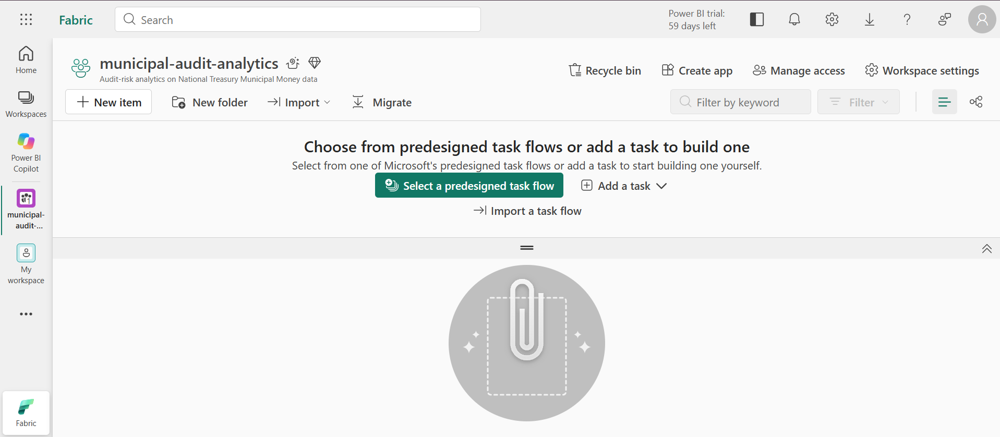
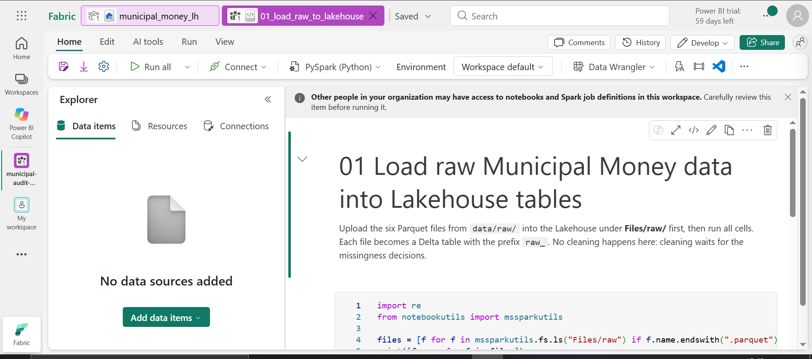
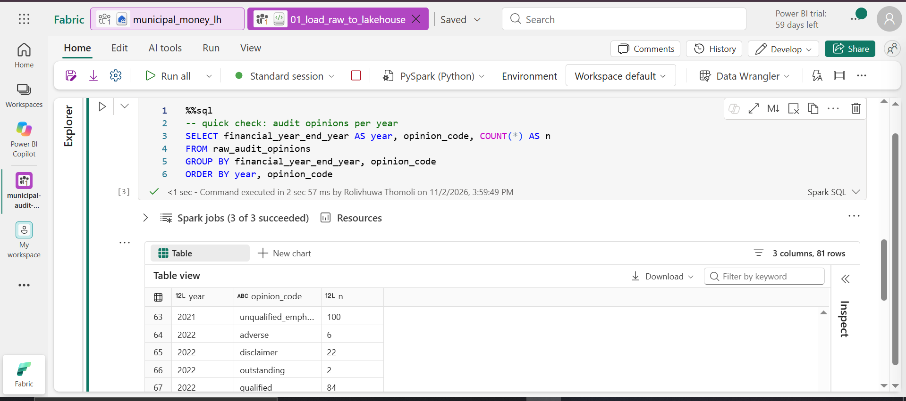
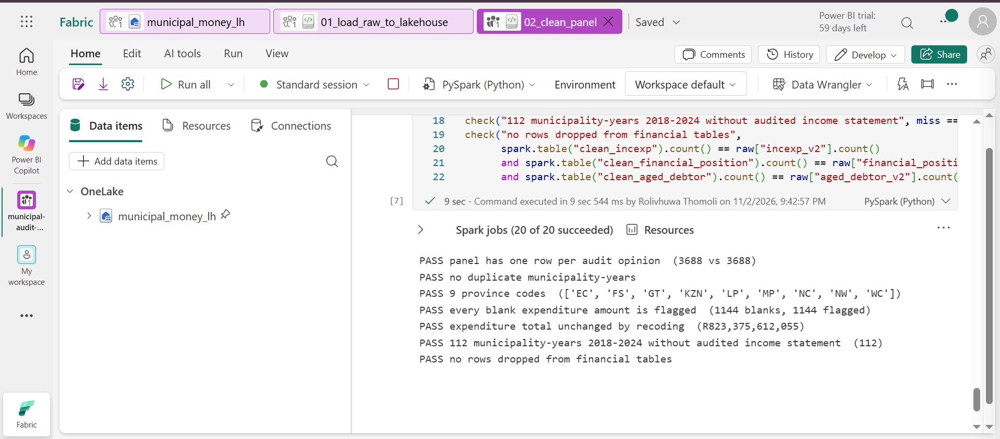
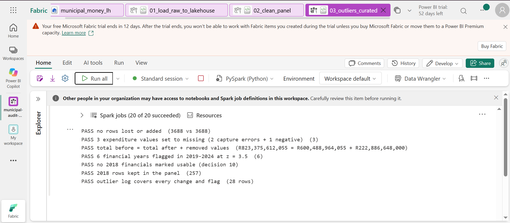
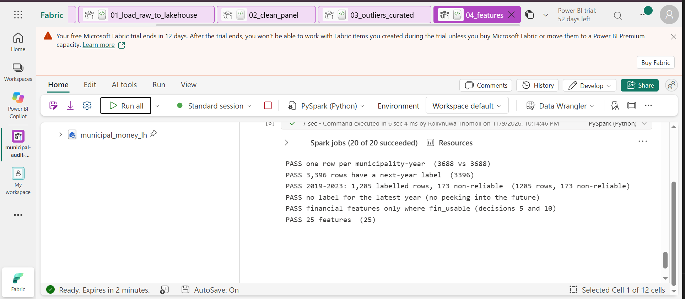

# Municipal audit analytics

Audit-risk analytics on South African municipal finance data, built as a hands-on learning project in internal audit data analytics. The data comes from National Treasury's [Municipal Money](https://municipaldata.treasury.gov.za) portal: Auditor-General opinions, irregular and wasteful expenditure, and audited financial statements for all 257 municipalities.

**Question:** which financial and reporting signals flag a municipality at risk of a poor audit outcome?

## Key finding so far

> **The gaps in this data are not random.** Municipalities with worse audit outcomes are far more likely to be missing their audited financial statements. In audit terms, the missingness is itself a risk signal.

| Audit opinion (2018–2024) | Municipality-years with no audited financial statements |
|---|---|
| Outstanding (audit not finalised) | 38.0% |
| Disclaimer | 9.9% |
| Adverse | 9.3% |
| Qualified | 6.6% |
| Unqualified with findings | 2.7% |
| Unqualified (clean) | 1.8% |

### Chi-square tests of independence: missingness vs audit opinion

H₀: whether a record is missing is independent of the audit opinion. If the data were missing completely at random (MCAR), H₀ would hold.

| Table and gap tested | n | χ² | df | p-value | Cramér's V | Permutation p |
|---|---|---|---|---|---|---|
| Income & expenditure: no audited statements (2018–2024) | 1,799 municipality-years | 163.7 | 5 | 1.6 × 10⁻³³ | 0.30 | < 0.001 |
| Balance sheet: no audited statements (2018–2024) | 1,799 municipality-years | 166.3 | 5 | 4.6 × 10⁻³⁴ | 0.30 | < 0.001 |
| Aged debtors: no audited figures (2020–2024) | 1,285 municipality-years | 62.7 | 5 | 3.4 × 10⁻¹² | 0.22 | < 0.001 |
| Irregular & wasteful expenditure: blank amount (2012–2017) | 4,833 amounts | 452.6 | 5 | 1.4 × 10⁻⁹⁵ | 0.31 | < 0.001 |

All four reject H₀, with moderate effect sizes (Cramér's V 0.22–0.31). The direction differs, and that difference matters:

- **Audited statements:** missing far more often for poor or outstanding audits, so the gap signals risk.
- **Irregular & wasteful expenditure:** blanks are most common for **clean** audits (51.9%, against 10.8% for qualified audits). This fits "blank meant nothing to report": from 2018 Treasury records zeros instead of blanks.

**Checks on the test's assumptions:**
- *Small expected counts:* the two statement tests have 17% of cells with an expected count below 5. That is within Cochran's 20% rule. A 2,000-draw permutation test, which doesn't depend on that rule, gives the same answer.
- *Independence:* each municipality appears in several years, so the observations are not fully independent and the p-values are somewhat optimistic. The size of the gaps (38% against 1.8%) leaves no doubt about the conclusion. Later modelling will account for this clustering.

Code: `src/eda_02_chisquare_missingness.py`.

These results rule out deleting incomplete records (complete-case analysis is only unbiased when data is missing completely at random; Rubin 1976), because doing so would drop the very municipalities an auditor most needs to see.

## Data decisions

| Issue | Decision | Why |
|---|---|---|
| Missing audited financial statements | Keep as a "did not submit audited statements" risk flag | This is a predictive model, and the missingness is informative (Sperrin et al. 2020). No causal claims are made from it (Groenwold et al. 2012) |
| Year range | Keep all years in cleaned tables; each analysis applies its own filter | Don't delete rows until needed. Financial line items are only comparable from 2018 (mSCOA), while audit and expenditure history goes back to 2011/2012 |
| Confirmed error values (two 2012 expenditure figures over 100 times the municipality's budget; a negative expenditure; financial years with broken totals) | Set to missing with a flag; original kept in its own column and in an outlier log | To avoid guessing the true value (Aguinis et al. 2013) |
| 2018 financial statements (first year of mSCOA) | Flagged as not usable for financial features; rows kept | Retains the information while avoiding training models on transition-year noise |
| Genuine extreme values (e.g. metros' multi-billion irregular expenditure) | Kept; scaled with ratios and logs in the features step | They are the audit findings, so the original information is retained |
| Province codes | Merge KZ into KZN and LIM into LP | The source table used two codes for the same province |
| Blank irregular-expenditure amounts (2012–2017) | Recode to zero, keep a `was_blank` flag | Treasury switched from blanks to zeros in 2018 (blank and zero rates add to a steady 17–32% each year), and blanks are most common in clean audits. Imputing would invent spending for municipalities that probably had none. Dropping would remove mostly clean municipalities and skew the data towards bad ones |

## Stack

| Layer | Tool | Why |
|---|---|---|
| Language | Python | Simple to read and review, widely used in audit analytics |
| Storage and SQL | Microsoft Fabric Lakehouse | Learn a modern lakehouse: Delta files plus a SQL endpoint |
| Dashboard | Power BI | Standard reporting tool for audit teams, connects natively to Fabric |
| Version control | GitHub | Every change is traceable and reversible, an audit trail for the analysis itself |

## Data

| Table | Rows | Content |
|---|---|---|
| audit_opinions | 3,688 | Auditor-General opinion per municipality-year, 2011–2024 |
| uifwexp | 10,314 | Unauthorised, irregular, fruitless and wasteful expenditure, 2012–2024 |
| incexp_v2 | 338,484 | Income and expenditure, annual totals per line item (mSCOA, 2018+) |
| financial_position_v2 | 321,481 | Balance sheet, annual totals per line item (mSCOA, 2018+) |
| aged_debtor_v2 | 45,374 | Debtors by age bucket (audited from 2020) |
| municipalities | 292 | Name, province, category |

Reproduce with `pip install -r requirements.txt && python src/pull_data.py data/raw`. The API resets connections now and then, so the script retries with backoff.

## Progress

1. **Data pull** (`src/pull_data.py`): done.
2. **Fabric load** (`fabric/01_load_raw_to_lakehouse.ipynb`): done. Parquet files in `Files/raw/` become `raw_*` Delta tables, row counts reconciled to source.
3. **EDA step 1: missingness** (`src/eda_01_missingness.py`, `src/eda_02_chisquare_missingness.py`): done. Key finding: missing audited statements are strongly linked to poor audit opinions (38% of outstanding audits against 1.8% of clean audits, chi-square p < 0.001). The gaps are not random, and they are themselves a risk signal.
4. **Cleaning** (`fabric/02_clean_panel.ipynb`): builds `clean_*` tables and a municipality-year panel, applying the data decisions above, with 7 reconciliation checks, all passing in Fabric. No rows deleted; `mscoa_era` flags 2018+.
5. **EDA step 2: outliers** (`src/eda_03_outliers.py`): done. Two 2012 capture errors alone added R223 billion (27% of all irregular, fruitless and unauthorised expenditure); 2018 is unreliable for many municipalities; Benford's law shows no systematic manipulation.
6. **Curated layer** (`fabric/03_outliers_curated.ipynb`): applies the outlier decisions and writes `curated_*` tables plus an outlier log (28 entries), with 7 reconciliation checks, all passing in Fabric.
7. **Target:** next year's audit opinion, **reliable** (unqualified, unqualified with findings, qualified) vs **non-reliable** (adverse, disclaimer, outstanding). This mirrors ISA 705's pervasive opinions. 2020–2024: 1,112 reliable vs 173 non-reliable.
8. **Features** (`fabric/04_features.ipynb`): 25 features across audit history, reporting discipline, irregular expenditure, liquidity, debt collection, spending structure and context. No leakage: features use year *t*, the label is year *t+1*. No manual selection: regularisation decides.
9. Next: model, Power BI dashboard.

## Fabric screenshots

| Workspace on trial capacity | Load notebook |
|---|---|
|  |  |

Spark SQL check after the load: 81 year-by-opinion rows, matching the source exactly.

Cleaning notebook: all 7 reconciliation checks pass (no rows lost, no duplicates, every blank flagged, expenditure total unchanged at R823.4 billion).

Curated layer: all 7 outlier checks pass. Every rand is accounted for: R823.4bn before = R600.5bn after + R222.9bn of confirmed errors set to missing.

Features: all 6 checks pass, including no label for the latest year (no peeking into the future).

